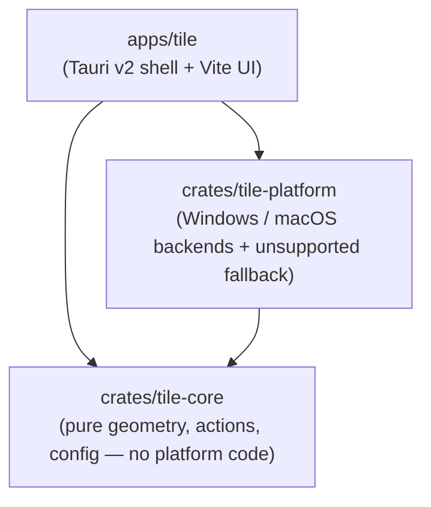

# Tile

**Keyboard-driven window management for Windows and macOS.**

Tile is a cross-platform window management app built from scratch in Rust. Snap
the focused window to halves and thirds of the screen, maximize it, or undo the
last move — all from the arrow keys.

The first-run guide offers **Launch Tile when I log in**, enabled by default so
the shortcuts are ready after a restart. The same setting remains available in
Settings and is restored to on by **Restore defaults**.

> **Status: early days.** Tile focuses on nine keyboard actions across two
> configurable modifiers — left, right, center column, maximize, restore, and
> directional display moves — plus single-hold corner composition and repeat
> size cycling. Per-app rules and drag-snapping are not built yet. This README
> documents only what actually works today.

## Default keyboard shortcuts

Shortcuts are organised into two groups, each with its own configurable
modifier (**Base modifier** for placement, **Display modifier** for moving
across displays) and per-action keys. By default, only the modifiers differ by
platform:

- **macOS** — Base modifier: `Control` + `Option`; Display modifier: `Control` + `Option` + `Command`
- **Windows** — Base modifier: `Win`; Display modifier: `Win` + `Alt`

Hold the **Base modifier**, then press:

| Key             | Action                                                             |
| --------------- | ------------------------------------------------------------------ |
| `←` `→`         | **Left / Right** — half, then two thirds, then a third (see below) |
| `↑`             | **Maximize**                                                       |
| `↓`             | **Restore** to the window's previous position                      |
| `←` / `→` then `↑` / `↓` | **Corner** — top or bottom of that side, keeping its width |
| `Enter`         | **Center Column** — full height, centred; repeat to cycle its width |

Hold the **Display modifier**, then press an arrow to move a window to an
adjacent display while keeping its slot:

| Shortcut                            | Action                                       |
| ----------------------------------- | -------------------------------------------- |
| **macOS** `Control`+`Option`+`Command`+`←` `→` `↑` `↓` | **Display Left / Right / Above / Below** — same slot |
| **Windows** `Win`+`Alt`+`←` `→` `↑` `↓` | **Display Left / Right / Above / Below** — same slot |

That is the entire keymap — **the arrows, `Enter`, and the display moves.**
Both platforms keep the same shape, with the modifier held in the left hand and
the keys in the right.

The horizontal pair places the window and carries every width, because repeating
a placement key cycles its size:

```text
  ←   ½ → ⅔ → ⅓ → …   anchored left
  →   ½ → ⅔ → ⅓ → …   anchored right
```

The vertical pair is the bigger/undo axis: `↑` maximizes and `↓` restores the
window.

Corners are composed rather than bound separately. Keep the **Base modifier**
held, press your `Left` or `Right` key (as often as you like, to pick a width),
then your `Maximize` or `Restore` key: the window moves to that side's top or
bottom corner at the width it had. While the modifier is still held, pressing
that side's key cycles the corner's width, and the opposite side key resets to a
full-height placement on the other side. Vertically, `Maximize` and `Restore`
step along `Top ↔ Full ↔ Bottom` keeping the current width, while pushing past
the ends — `Maximize` from a top corner or `Restore` from a bottom corner —
maximizes or restores and ends composition. Let go of the modifier and
`Maximize`/`Restore` resume their plain meaning. Corner composition follows
whatever **Base modifier** and `Left` / `Right` / `Maximize` / `Restore` keys
you configure in Settings.

`Enter` (Return) centres a full-height column and cycles its width the same way
the side keys do.

In **Settings ▸ Shortcuts**, choose each group's modifier from platform presets
(or pick **Custom…** to toggle individual modifier keys) and click any action's
key to rebind or clear it.

### The tray and menu-bar menu

The tray (Windows) or menu-bar (macOS) menu offers the nine actions directly,
each showing its current shortcut:

```text
Left · Right · Center Column
Maximize · Restore
Displays  ▸  Left · Right · Above · Below
```

Clicking `Left`, `Right`, or `Center Column` repeatedly cycles through the
configured sizes just like repeating its shortcut. Actions apply to the window
that was frontmost before the menu opened.

### Press it again to change the size

Pressing the same shortcut again changes the size. `Left`, `Right`, `Center
Column`, and composed corners **cycle through sizes**: half, two thirds, third,
then back to half. Corners cycle their width while keeping their half height.

The sizes are configurable in Settings ▸ Behaviour ▸ Repeating shortcuts — ½,
⅔, ¾, ¼ and ⅓. A half, two thirds and a third are enabled by default; enable ¼
or ¾ for extra steps, or turn cycling off so repeats do nothing.

The cycle restarts whenever you run a different action, switch to another
window, or move the window yourself, and `Restore` always returns the window
to where it was **before** Tile first touched it, however long you cycled for.

### Moving between displays

The display arrows follow the physical layout configured in your OS: use
`←`/`→` for side-by-side monitors and `↑`/`↓` for stacked monitors. The nearest
display beyond that edge is selected, preferring displays aligned on that axis
over diagonal ones. If there is no display in that direction, nothing moves;
these shortcuts do not wrap.

All display moves keep the window's slot where they can: a left third or
two-thirds corner stays in that slot on arrival. A window that is not in a
recognisable slot keeps its **relative** place instead, so something filling the
right half of a 4K panel fills the right half of a 1080p one rather than hanging
off its edge. That holds across mixed-DPI desks, because the placement is
computed as fractions of each display's own work area rather than by scaling
pixels.

### Configuration format

`config.json` carries a `schemaVersion` (currently `2`; older v1 files migrate
automatically on load, silently dropping retired actions and unused fields).
Settings are read one at a time, so a hand edit that leaves one value with the
wrong type resets only that value. If `config.json` cannot be read at all — say,
after a hand edit leaves it invalid JSON — Tile starts from defaults. Either
way, and also when the file comes from a newer Tile, the original is kept next
to it as `config.corrupt-<timestamp>.json` (the newest five are kept) and
Settings opens once to say so.

### Animated snapping

Windows and macOS glide to their new frame rather than jumping to it. Both use
a rigid rectangle and a restrained, monotonic ease-out, paced automatically to
the target display's refresh rate (capped at 45 fps on macOS to keep
Accessibility IPC smooth on ProMotion displays). On every platform, a shortcut
pressed while a window is still in flight redirects the movement it already has
instead of restarting it.

**This is on by default.** Turn it off in Settings ▸ Behaviour ▸ Motion for
instant snapping (useful over remote desktop or if you prefer no motion). How
long a snap takes is controlled by the duration slider in the same place, from
40 ms to 1000 ms (defaulting to 250 ms on macOS and 220 ms on Windows):

```jsonc
"animation": {
  "enabled": true,
  "durationMs": 220 // 250 on macOS; how long a snap takes; 40–1000
}
```

### Windows shortcut notes

Tile intercepts the bound `Win`+Arrow shortcuts to replace Aero Snap, and claims
`Win`+`Alt`+Arrow — Windows 11's snap variants — for the display moves. Other
shortcuts are registered directly with Windows whenever possible. `Win`+`Shift`+Arrow
(Windows' own move-between-monitors shortcut) and `Win`+`Ctrl`+`←`/`→` (virtual
desktops) both remain available.

Windows treats `Ctrl`+`Alt` as `AltGr` on many international layouts, so Tile
does not use that modifier by default; doing so could interfere with characters
such as `@`, `€`, `{` and `}`.

<sub>Defaults live in `crates/tile-core/src/config.rs` (`BASE_MODIFIERS`,
`DISPLAY_MODIFIERS`, and `default_keys`) — the single source of truth.</sub>

## Platform notes

### Windows: registered shortcuts and selective interception

Tile registers shortcuts with Windows using `RegisterHotKey` whenever the OS
will grant them. A **low-level keyboard hook** (`WH_KEYBOARD_LL`) is installed
whenever at least one active feature needs behavior that registration cannot
provide:

- overriding a shortcut Windows already owns, including the default
  `Win`+Arrow set that **replaces Aero Snap**;
- distinguishing main Enter from numpad Enter;
- tracking modifier releases for single-hold **corner composition**.

Assigning a shortcut means Tile claims it exclusively whenever Windows permits.
Tile chooses the mechanism automatically: ordinary shortcuts are registered,
while Windows-owned and key-identity-sensitive shortcuts are intercepted. When
no active shortcut needs interception, Tile installs no keyboard hook at all.

Input delivery and permission to move a window are separate. A registered
shortcut can reach Tile while an elevated (administrator) app is focused, but
Windows may still deny Tile permission to manipulate that app unless Tile is
also elevated. Some corporate security software may flag or block the hook when
interception is active.

Windows can silently drop a keyboard hook across sleep, lock or a long stall.
Tile re-installs its hook after resume, unlock and display wake, and
re-checks its registered shortcuts, so they keep working without a restart.

### macOS: Accessibility permission

macOS requires you to grant Tile the **Accessibility** permission before it can
move other applications' windows. Grant it under:

**System Settings ▸ Privacy & Security ▸ Accessibility** → enable **Tile**
(on macOS 12 and earlier: **System Preferences ▸ Security & Privacy ▸ Privacy ▸
Accessibility**). This is not the top-level *Accessibility* section of System
Settings, which holds display and pointer options.

Tile picks up the change by itself within a couple of seconds; there is no need
to restart it. While the permission is missing, Tile's settings window shows the
steps, and the menu bar menu starts with **Grant Accessibility Permission…**.
Tile keeps checking in the background, so if the permission is switched off
later, the same steps come back.

- **Tile is not in the list:** click **+** and choose Tile, or use **Show Tile
  in Finder** in Tile's settings and drag the app into the list. A build run
  with `cargo run` is not an app bundle, so macOS may list the app that started
  it (such as Terminal) instead.
- **Tile is listed and switched on, but shortcuts do nothing** (this can happen
  after an update or a rebuild): select Tile, remove it with **−**, and add it
  again. Tile cannot tell this case apart reliably, so it does not try to.
- **Managed Macs:** your organization may lock this setting. Ask your
  administrator.

Builds you compile yourself are unsigned, so Gatekeeper blocks their first
launch. Remove the quarantine attribute:

```sh
xattr -dr com.apple.quarantine /Applications/Tile.app
```

…or right-click the app in Finder and choose **Open** the first time. Builds
published on the [Releases](https://github.com/filipmares/tile/releases) page are
signed and notarized and need neither — each release's notes say so explicitly,
and tell you what to do if a particular build was not signed.

## Installation

### From Releases

Grab the latest build from the [Releases](https://github.com/filipmares/tile/releases)
page:

- **macOS:** the universal `.dmg` (runs on both Apple Silicon and Intel). Open
  it and drag **Tile** into Applications. Signed and notarized builds open
  without a Gatekeeper workaround; follow the release notes if a build is
  marked unsigned.
- **Windows:** `Tile_<version>_x64-setup.exe`. It installs for the current user
  only, so there is no administrator prompt, and it pulls in the WebView2
  runtime automatically if the machine lacks it. Unsigned builds make
  SmartScreen warn that the publisher is unknown — choose **More info ▸ Run
  anyway**.

Tile has no main window: after launching, look for its icon in the menu bar
(macOS) or the system tray (Windows). The first launch opens a welcome window
that deals you the default shortcuts one at a time — press one and the deck
moves on. You can reopen it any time from the bottom of **Settings…**.

### From source

See [Build from source](#build-from-source).

### Logs and troubleshooting

Tile keeps a rotating log (`tile.log`, then `tile.1.log` … `tile.4.log`, about
1 MB each) so a launch that did not happen or a silent exit can be explained
afterwards:

- **Windows:** `%APPDATA%\Tile\Tile\data\logs`
- **macOS:** `~/Library/Application Support/dev.Tile.Tile/logs`

Development builds log under `Tile-Development` instead. Timestamps are UTC, and
each line carries the process ID and thread. Every launch begins with the
version, executable and how Tile was started: launches by the OS login item
carry `--autostart` and are logged as `via the OS login item`. The log also
records the login item's state (and any repair), the hotkey route summary,
update checks and installs, every orderly exit with its reason, and any panic
with a backtrace. A launch that follows a process which was killed or crashed
is flagged with `did not exit cleanly`. Set `RUST_LOG` (for example
`tile_app=debug,tile_platform=debug`) for more detail.

**Tile did not start at sign-in?** Check the log first. No `starting … via the
OS login item` line for that sign-in means Windows never launched it: confirm
**Launch Tile at login** is on and that Tile is enabled under Task Manager ▸
Startup apps. Waking from sleep or hibernation does not start apps, so Tile
has to have been running beforehand. Upgrading with the setup `.exe` used to
remove the login item; current installers restore it.

**Custom title bars on Windows:** Tile supports resizable windows without a
native title bar, including the Copilot app. Child windows, tool windows, and
hidden or cloaked windows are excluded from tiling.

### Uninstall

- **Windows:** quit Tile from the tray, then uninstall it from **Settings ▸
  Apps ▸ Installed apps**. The uninstaller also removes the sign-in login item
  (`HKCU\Software\Microsoft\Windows\CurrentVersion\Run\Tile`).
- **macOS:** turn off **Launch Tile at login** in Settings first, then quit Tile
  and move it from Applications to the Trash. If Tile is already gone, delete the
  login item it left behind:

  ```sh
  rm ~/Library/LaunchAgents/Tile.plist
  ```

Settings and logs are left in place so a reinstall keeps your shortcuts.
Delete them to remove every trace:

- **Windows:** `%APPDATA%\Tile\Tile` (`config\config.json` and `data\logs`)
- **macOS:** `~/Library/Application Support/dev.Tile.Tile`

Development builds use `Tile-Development` in place of the last `Tile`.

## Build from source

### Prerequisites

- **Rust** (stable) — install with [rustup](https://rustup.rs/).
- **Node.js 18+** and npm — for the frontend under `apps/tile/ui`.
- **Windows:** Visual Studio **C++ Build Tools** + **Windows SDK** (provides
  `link.exe`) and the **WebView2** runtime (preinstalled on Windows 11).
- **macOS:** **Xcode Command Line Tools** (`xcode-select --install`).

### Build

```sh
# 1. Frontend dependencies
cd apps/tile/ui && npm ci && cd ../../..

# 2. Build and test the workspace
cargo build --workspace --release
cargo test --workspace
```

### Run the app

```sh
cd apps/tile

# Development: hot-reloading settings UI
./ui/node_modules/.bin/tauri dev

# Release installers. Add `--bundles nsis` on Windows to build only the NSIS
# setup .exe, which is what releases ship; the default also builds an .msi.
./ui/node_modules/.bin/tauri build
```

Installers are written to `target/release/bundle/`. The app has no main
window — look for the icon in the system tray (Windows) or menu bar (macOS),
and choose **Settings…** from its menu.

### Development builds are kept apart from an installed Tile

Anything you build yourself — including `tauri build` — is a **development
build**, and it deliberately stays out of the way of a copy of Tile you have
installed from a release:

- It stores its settings in a separate directory (`Tile-Development` beside the
  installed `Tile` one), so experimenting cannot corrupt or migrate your real
  `config.json`.
- It never touches the system login item. **Launch Tile at login** is saved in
  the development config but not applied, so it cannot repoint or remove the
  login item belonging to the installed copy.
- It says so: the menu bar / tray menu is headed *Tile — Development build*,
  the tray tooltip and settings window title are suffixed *(Development)*, and
  the settings window shows a panel naming its config directory.

What makes a build "installed" is the `TILE_BUILD_KIND=installed` environment
variable, which only the release workflow sets. Absent, empty or misspelled, a
build classifies as development — the safe direction to fail in. See
[`apps/tile/src/build_kind.rs`](apps/tile/src/build_kind.rs).

## Testing

Most of Tile is verifiable without a desktop. `cargo test --workspace` covers
the tiling geometry, the restore history, hotkey parsing, the Windows
`KeyCode`→virtual-key tables and DWM frame arithmetic, and the macOS
coordinate flip — the last of these runs on every platform, not just macOS.

The macOS backend can also be type-checked from Windows or Linux, which is
how it is validated on every pull request:

```sh
rustup target add aarch64-apple-darwin
cargo clippy -p tile-platform --target aarch64-apple-darwin --all-targets -- -D warnings
```

Two things genuinely need a live desktop session, so they ship as examples
rather than tests:

```sh
# Moves a real window through every action and asserts it lands pixel-exact.
# Pass a window handle to target a specific window instead of the focused one.
cargo run --example live_smoke -p tile-platform

# Exercises real RegisterHotKey and conditional-hook routes, injects safe test
# combinations, and checks delivery, route transitions, and unbinding.
cargo run --example live_hotkey -p tile-platform
```

To test the shortcuts end to end, build and start the app, open a window you
do not mind moving, and press <kbd>Win</kbd>+<kbd>←</kbd>. An elevated target
may reject the window operation even when the shortcut itself was delivered
successfully.

For a local Windows debugging session, enable Tile's app and platform logs in
the PowerShell window that launches Tauri:

```powershell
$env:RUST_LOG = "tile_app=debug,tile_platform=debug"
Set-Location apps\tile
.\ui\node_modules\.bin\tauri dev
```

The terminal reports each applied shortcut's route (`Registered`,
`Intercepted`, or `Unavailable`), whether the keyboard hook was
installed or removed, registered-shortcut dispatch, performed window actions,
and apply/rollback failures. The hook callback itself deliberately does not log:
Windows can silently remove a low-level hook if its callback blocks for too
long. Logs go to the launching terminal and to the log file described in
[Logs and troubleshooting](#logs-and-troubleshooting).

## Architecture

Tile is split into three crates with a strict dependency direction, so the
interesting logic stays testable and every OS API lives behind a trait:



- **`tile-core`** is pure and platform-independent — geometry math, the window
  actions, hotkey definitions, config load/save, and the decision `Engine`. It
  does no I/O beyond JSON and is **heavily unit-tested**, so all of Tile's
  behaviour can be verified on any host (including Linux CI).
- **`tile-platform`** isolates every OS API behind two traits (window
  manipulation and global hotkeys), with a Windows backend, a macOS backend,
  and an `unsupported` fallback so the crate still compiles on other platforms.
- **`apps/tile`** is a thin [Tauri v2](https://v2.tauri.app/) desktop shell with
  a vanilla TypeScript + Vite frontend — it wires `tile-core`'s engine to
  `tile-platform`'s backends and shows the tray/menu-bar UI.

## Continuous integration

Because the primary development machine is Windows-only, **GitHub Actions is the
only place the macOS build is ever compiled** — so CI is intentionally thorough
and fails loudly. Every push and pull request runs `cargo fmt`, `cargo clippy
--workspace --all-targets -- -D warnings`, and `cargo test` on Windows and
macOS, plus a Linux job for the platform-independent crates. See
[`.github/workflows/ci.yml`](.github/workflows/ci.yml).

## Contributing

Contributions are welcome! Please read [CONTRIBUTING.md](CONTRIBUTING.md) for
the project layout, prerequisites, and the checks CI expects.

## Acknowledgements

Tile is inspired by [Rectangle](https://github.com/rxhanson/Rectangle) by Ryan
Hanson. Tile is an independent Rust implementation.

## License

Tile is released under the [MIT License](LICENSE), © 2026 Filip Mares.
